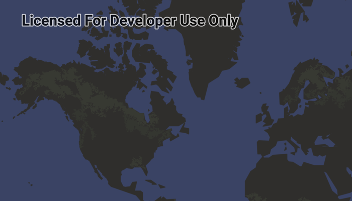

# Clip a field function to map view extent

Clip a field function to a changing area of interest within the map view and automatically update the analysis as the map is navigated.

## Use case

Spatial analysis workflows may only need to process the area currently being viewed or investigated. For example, a suitability analysis might evaluate potential locations within a specific area of interest rather than across the full extent of the input data. A clip field function can restrict the analysis to that area and update the clip extent dynamically as the area of interest changes.

Updating the clip extent does not require the analysis to be rebuilt. Restricting the field function to a smaller extent
can also reduce unnecessary processing and improve performance, particularly on devices with limited graphics processing
resources. Note that analysis is performed at the full resolution of the source data.

## How to use the sample

When the sample opens, the map displays elevation within a clipped extent centred on the map view. The clipped analysis area covers 60 percent of the visible extent and is outlined on the map. Pan or zoom the map to explore different parts of the elevation dataset. As the viewpoint changes, the analysis area moves with the map view and the field function is clipped to the new extent. Select **Settings** to adjust the minimum and maximum elevation values displayed by the analysis. The analysis updates automatically to display elevation values within the selected range and clips them to the current analysis area.

## How it worksTODO

1. Create an `AnalysisOverlay` and a `GraphicsOverlay`, then add both overlays to the map view.
2. Create a `ContinuousField` from an elevation raster file using `ContinuousField.createFromFiles`.
3. Create a `ContinuousFieldFunction` from the continuous field using `ContinuousFieldSupplier`.
4. Create two `FloatSupplier` instances to provide the minimum and maximum elevation values.
5. Create a `BooleanFieldFunction` that identifies elevation values within the supplied range using `isGreaterThanOrEqualToFunction`, `isLessThanOrEqualToFunction`, and `logicalAnd`.
6. Apply the boolean selection to the continuous field function using `mask` to retain only elevation values within the selected range.
7. Create a `ContinuousFieldClipFunction` from the masked elevation function.
8. Create a `FieldAnalysis` from the clip function using `FieldAnalysis.withContinuousFieldFunction` and a `StretchRenderer`.
9. Add the field analysis to the analysis overlay.
10. Listen for map viewpoint changes using `onViewpointChanged`.
11. Get the current visible area from `ArcGISMapViewController.visibleArea`. Use `Envelope.fromCenter` to create an inset `Envelope`, centred on the visible extent.
12. Update the clip extent graphic and set the `ContinuousFieldClipFunction.extent` property to the resulting envelope.
13. Update the float suppliers' `value` properties to update the analysis result dynamically.

## Relevant API

* AnalysisOverlay
* BooleanFieldFunction
* ColorRamp
* ContinuousField
* ContinuousFieldClipFunction
* ContinuousFieldFunction
* ContinuousFieldSupplier
* FieldAnalysis
* FloatSupplier
* StretchRenderer

## Offline data

The sample uses a [10m resolution digital terrain elevation raster of the Isle of Arran, Scotland](https://www.arcgis.com/home/item.html?id=aa97788593e34a32bcaae33947fdc271)
(Data Copyright Scottish Government and SEPA (2014)). It is downloaded from ArcGIS Online automatically.

## Tags

clip, elevation, extent, map algebra, raster, spatial analysis, terrain
