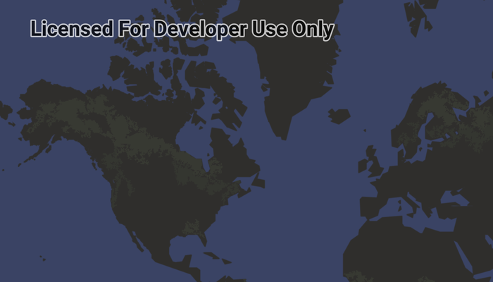

# Get field function value from a point

Sample field function values at a given position from a field analysis.

## Use case

Many spatial workflows depend on sampling a specific location and keeping the result current as information changes. In flight planning for an aircraft flying over uneven terrain, elevation and ground clearance at a location provide useful context, especially when readings reflect updates to the planned altitude of the aircraft.

## How to use the sample

The sample opens displaying both an elevation field (purple-gray tones) and a boolean field that shows where an aircraft flying with an altitude of 2000m above sea level would not have ground clearance (red). The ground clearance field is determined by subtracting the elevation field from an altitude value. A callout in the centre of the data displays the values of each field, which have been sampled from the callout's position. Tap, or tap and drag the map to sample the values of each field across the data extent from the tapped position. Open the settings tab to adjust the altitude value and see the ground clearance's spatial extent update across the map. The tapped position's sampled value of the ground clearance boolean field will update automatically.

Red areas indicate terrain that would have no ground clearance given the set altitude value.

## How it works

1. TODO

## Relevant API

* AnalysisOverlay
* BooleanFieldFunction
* BooleanFieldSampleFunction
* ContinuousField
* ContinuousFieldFunction
* ContinuousFieldSampleFunction
* ContinuousFieldSupplier
* FieldAnalysis
* FloatSupplier

## Offline data

This sample uses [1m resolution digital terrain elevation raster of the area over Méribel](https://www.arcgis.com/home/item.html?id=6bb0ad0e3bd5410fa52191184578f0b2), in the French Alps. It is downloaded from ArcGIS Online automatically.

## Tags

analysis overlay, elevation, field analysis, interactive, map algebra, raster, sample, spatial analysis, terrain
